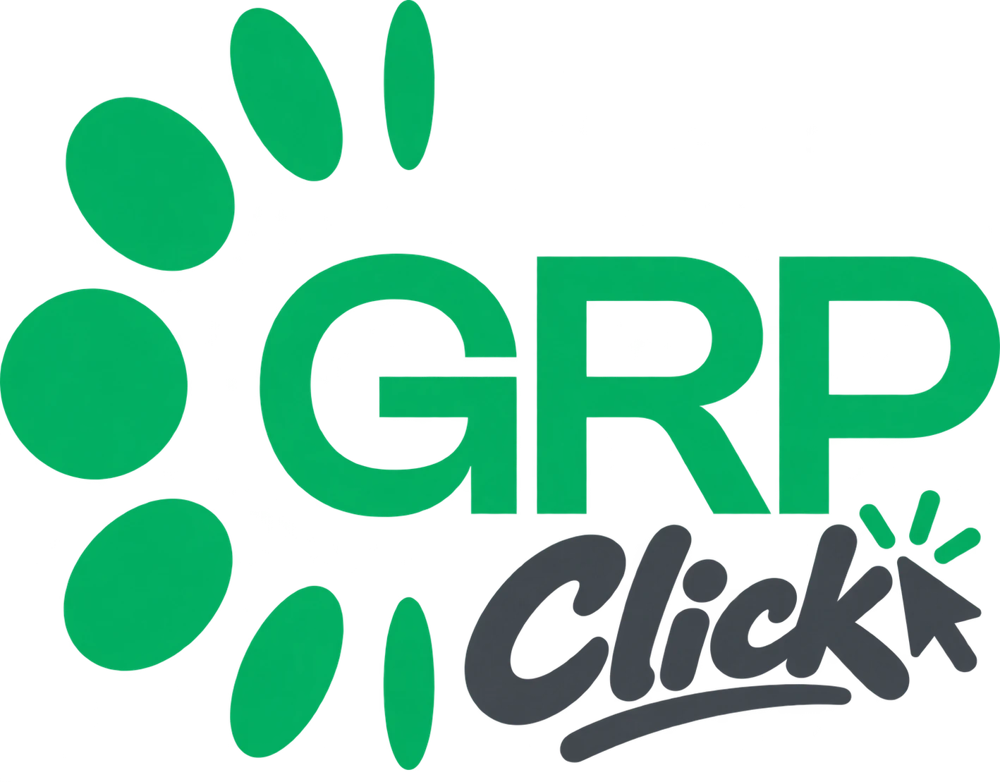

## GRP Click

Controls PowerPoint (Mac and Windows) and Keynote (Mac) on presentation machines, through the **GRP Click** app installed on each one.

1. Install and open GRP Click on each presentation machine. Its window shows the IP address to use.
2. Put each machine's IP address into this connection (Machines 1–10). Leave the port at 8765.

GRP Click never opens PowerPoint or Keynote itself: open the presentation first. If both are open on a Mac, it controls the one with a slideshow running (or, failing that, a presentation open, or in front).

**Actions** (each has a **Machine** option): next, previous, first, last, go to slide number, start show, end show.
Go to slide works in Keynote and PowerPoint for Windows. PowerPoint for Mac can't do it.

**Presets** for Machines 1 and 2 (change the Machine option on a button for others). Buttons turn **red** when the machine can't be reached and **amber** when the last command didn't work (for example, no slideshow running). The **Slide** button shows the app and where the show is, e.g. *Keynote 2/12*, and goes **green** while a show is running. It follows the presenter's own clicker too. The status button shows Connected / Not connected.

**Variables:** `mN_slide` (e.g. 2/12, End, Not started), `mN_slide_number`, `mN_slide_total`, `mN_app` (PowerPoint or Keynote), `mN_status`, `mN_platform` (Mac or Windows), `mN_version` (GRP Click version), `mN_error` (last error), where N is the machine number.

No password: use it only on a private show network.
